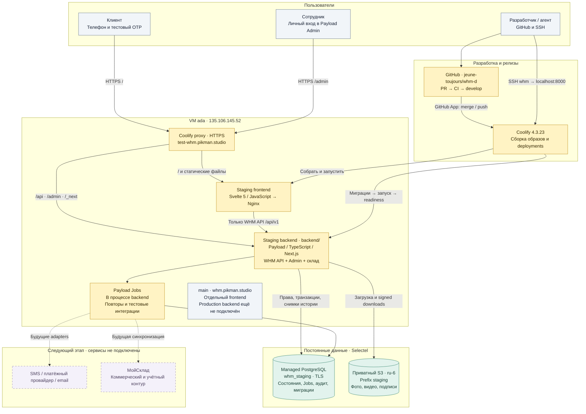
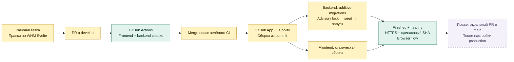

# WHM D: устройство системы и доступы

Состояние на 11 октября 2026. Описана действующая тестовая инфраструктура. Технические решения — master plan от 04.10.2026; главный эталон клиентских экранов и сценариев — наши WHM Svelte-файлы в корне репозитория.

Документ со схемами в [Notion WHM D](https://app.notion.com/p/3f675fc615c881e0b377d7d16c845e72).

## Карта контуров



Сплошные связи — действующий контур; пунктирные — будущие подключения. Браузер работает через WHM API. PostgreSQL является источником продуктового состояния; S3 хранит файлы. Очередь Jobs использует PostgreSQL и выполняется внутри backend, отдельного сервера очереди нет.

## Что где размещено

| Компонент | Где | Что делает |
| --- | --- | --- |
| Svelte frontend | VM, отдельный Nginx container | Клиентские экраны, формы, обе темы, обращения к API |
| Payload backend | VM, отдельный container, порт 3000 | API, сессии, серверные правила, транзакции, Admin и складские процессы |
| Coolify / proxy | Та же VM | GitHub App, Docker builds, маршрутизация HTTPS, состояние deployments |
| PostgreSQL | Managed Selectel, база `whm_staging` | Пользователи, вещи, заказы, подписки, платежные метаданные, обращения, события, Jobs |
| S3 | Selectel, приватный bucket/prefix `staging`, регион `ru-6` | Приёмочные материалы, фото/видео выдачи, подписи; signed URL на 5 минут |
| МойСклад / SMS / PSP / email | Пока не подключены | SMS, оплата и inbox разработчика симулируются; тестовая логистика задаётся fixtures |

VM должна быть восстанавливаемой: постоянные продуктовые данные вынесены в managed PostgreSQL и S3. Полный backup/restore drill ещё является отдельным условием production; наличие внешнего хранилища само по себе не подтверждает проверенную процедуру восстановления.

## Окружения

| Окружение | Ветка и адрес | Текущее состояние |
| --- | --- | --- |
| Staging | `develop` · https://test-whm.pikman.studio | Полный тестовый клиент, API, Admin, склад и Selectel persistence |
| Ветка будущего production | `main` · https://whm.pikman.studio | Ранее опубликованный frontend. Backend и отдельные production credentials пока не подключены |
| Локальная разработка | Рабочая ветка / PR | Vite frontend; backend требует отдельного dev/staging окружения. Архивный просмотр — отдельная сборка `VITE_DEMO_MODE=true` |

Оба публичных домена пока используются для разработки. Перед запуском настоящего production нужны отдельные PostgreSQL database/credentials, Payload secret, S3 bucket либо prefix/credentials и реальные integration settings. Staging никогда не использует production credentials. Пока выпускаем только в `develop`.

## Куда заходить

| Задача | Адрес / способ входа |
| --- | --- |
| Клиентское приложение | https://test-whm.pikman.studio · телефон и OTP из тестового SMS inbox |
| Стартовый тестовый клиент | `+7 999 000 00 01`; seed создаёт три вещи, последующие реальные тестовые операции меняют их состояние |
| Новый тестовый клиент | Номер диапазона `+7 999 000 XX XX`; имя и фамилия после OTP |
| Payload Admin | https://test-whm.pikman.studio/admin · сотрудник email/password |
| Администратор staging | `paul@pikman.studio`; пароль хранится отдельно от документации |
| Приёмка | https://test-whm.pikman.studio/admin/warehouse/receive |
| Размещение | https://test-whm.pikman.studio/admin/warehouse/place |
| Подбор возврата | https://test-whm.pikman.studio/admin/warehouse/pick |
| Выдача, фото и подпись | https://test-whm.pikman.studio/admin/warehouse/return |
| Операционная поддержка | https://test-whm.pikman.studio/admin/warehouse/support |
| Код и PR | https://github.com/jeune-toujours/whm-d |
| CI | https://github.com/jeune-toujours/whm-d/actions |
| VM | SSH alias `whm`, пользователь `pavel` |
| Coolify | Панель `http://127.0.0.1:8000` на VM; безопасный вход через SSH tunnel ниже |
| Selectel | Личный кабинет владельца; доступ к PostgreSQL/S3 через настройки соответствующих managed ресурсов |

Клиент и Admin на одном домене используют одну Payload cookie. Для одновременной работы с клиентом и сотрудником используйте разные профили браузера или приватное окно. Роли: `client` — только собственные данные; `warehouse` — складские операции; `manager` — клиенты, заказы, финансы и инциденты; `admin` — полный административный доступ. Технические обращения и их вложения скрыты от обычного backoffice и передаются через Jobs в тестовый inbox разработчика.

### SSH и Coolify

На текущем Windows-компьютере владельца:

```powershell
ssh -F C:/Users/pashr/.ssh/config whm
```

Для панели Coolify открыть отдельный терминал и оставить tunnel работающим:

```powershell
ssh -F C:/Users/pashr/.ssh/config -N -L 18000:127.0.0.1:8000 whm
```

Затем открыть `http://127.0.0.1:18000` в браузере и войти собственным аккаунтом Coolify. Это отдельный вход от Payload Admin. На компьютере коллеги путь к SSH config будет своим; нужно настроить ключ и alias с владельцем VM. Пользователь `pavel` не получает прямой доступ к Docker и sudo без пароля; агент управляет deployments через Coolify API по SSH.

## Настройки и секреты

Значения секретов не публикуются в Git/Notion. На VM файлы принадлежат `pavel`, права `600`:

| Файл | Назначение |
| --- | --- |
| `/home/pavel/.config/whm/coolify-token` | API-токен Coolify для агента |
| `/home/pavel/.config/whm/staging.env` | Исходные подключения, предоставленные владельцем |
| `/home/pavel/.config/whm/staging.runtime.env` | Адаптированные runtime variables backend, Selectel TLS CA и S3 |
| `/home/pavel/.config/whm/staging-admin.env` | Bootstrap credentials staging Admin |

Backend: `APP_ENV=staging`, `SIMULATE_INTEGRATIONS=true`, `SEED_STAGING=true`, `DATABASE_PUSH=false`. PostgreSQL TLS проверяет CA и имя сервера. Secrets заданы как runtime variables в Coolify и не передаются Docker build. Frontend: `VITE_DEMO_MODE=false`, `VITE_API_URL=/api`. Theme хранится в localStorage; временные черновики — в sessionStorage отдельно по клиенту. Заказы и вещи сохраняются сервером.

## Как выпускаем изменения



1. Наши корневые WHM Svelte-файлы определяют вид и клиентский сценарий; Notion дополняет требования и задаёт архитектуру. Расхождения фиксируем явно.
2. Изменения идут через рабочую ветку и PR. Frontend gates: `npm run check`, `npm run build`, `npm run test:flows` (включает layout regression). Backend меняется с typecheck/tests/build и миграциями при изменении схемы.
3. GitHub App автоматически реагирует на merge/push; перед merge ждём зелёного CI. Этот порядок не заменяет настройку принудительной защиты веток.
4. Новый backend образ применяет миграции до запуска Next. Schema push выключен; seed не очищает базу и не возвращает уже выданные вещи на склад.
5. Успешный релиз: оба deployment `finished`, приложения healthy, `/health`, `/release.json`, `/api/health`, `/api/ready` отвечают, frontend/backend SHA совпадают, браузерный сценарий пройден.
6. Откат образа или revert возвращает код. PostgreSQL автоматически не откатывается; `migrate:down` может удалить поля и требует отдельного решения.

На VM доступны команды, печатающие только безопасные метаданные:

```bash
cd /home/pavel/whm-d
python3 scripts/coolify.py list
python3 scripts/coolify.py status staging
```

Серверный checkout — вспомогательный каталог агента; Coolify собирает приложения из GitHub commit и не зависит от его текущей ветки. Идентификаторы ресурсов — `infra/coolify/environments.json`; текущий SHA проверяется на домене, а не по локальному checkout.

## Что остаётся перед настоящим запуском

Production backend и изоляция его credentials; коммерческие тарифы и регулярный биллинг; юридические документы; реальные SMS, платежи, email и МойСклад; физическое планирование доставки; backup/restore drill. Симулятор оплаты сохраняет статусы `pending/failed/paid/refunded`, но деньги не списывает, данные карты не собирает, квитанция не является фискальным чеком.

Ссылки на решения: [master plan](https://app.notion.com/p/3ef75fc615c881808c1fdcd5ffb69ea6), [сверка архивных сценариев](https://app.notion.com/p/3ef75fc615c881aaa1ffc5b5953a8d37), [порядок релизов](releases.md), [новый раунд проверки](responsive-audit.md).
